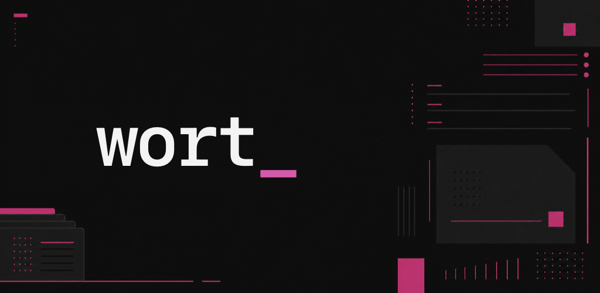

<div align="center">
  

  # wort_

  **A focused German dictionary, course companion, and offline practice app.**

  [](https://wort-five.vercel.app)
  [](https://github.com/YehorAltshuler/wort_/releases/latest/download/wort.apk)

  [English](README.md) · [Deutsch](README.de.md) · [Русский](README.ru.md)
</div>

## Learn German with context

wort_ combines a 29,599-entry German dictionary with course vocabulary,
targeted exercises, personal word lists, and an offline-first **Leben in
Deutschland** trainer. The same responsive Flutter application runs on Android,
iOS, and the Web.

### Highlights

- fast dictionary search, word details, examples, forms, and external references;
- vocabulary from four course books plus a LiD deck, across 37 learning modules;
- focused practice sessions, exercises, favorites, and custom collections;
- all 460 LiD questions, state selection, exam mode, statistics, and resumable sessions;
- offline-first storage with safe background dataset updates;
- light/dark themes, selectable color palettes, and adaptive text sizes;
- Russian, English, and Arabic application UI.

## Screens and layouts

The interface is built with Material 3 and shared responsive components. Content
keeps a readable maximum width on large displays, while navigation, statistics,
answer grids, and bottom sheets adapt to the available space without maintaining
a separate Web UI.

## Run locally

```bash
flutter pub get
flutter run --flavor native
```

For Web, run `flutter run -d chrome` (no flavor). See the
[development guide](docs/en/DEVELOPMENT.md) for platform setup, verification,
release builds, and publishing.

## Quality checks

```bash
dart format --output=none --set-exit-if-changed .
flutter analyze
flutter test
flutter build web --release
```

## Documentation

| Guide | English | Deutsch | Русский |
| --- | --- | --- | --- |
| Architecture | [Read](docs/en/ARCHITECTURE.md) | [Lesen](docs/de/ARCHITECTURE.md) | [Читать](docs/ru/ARCHITECTURE.md) |
| Development & releases | [Read](docs/en/DEVELOPMENT.md) | [Lesen](docs/de/DEVELOPMENT.md) | [Читать](docs/ru/DEVELOPMENT.md) |
| Dictionary | [Read](docs/en/LEXICON.md) | [Lesen](docs/de/LEXICON.md) | [Читать](docs/ru/LEXICON.md) |
| Leben in Deutschland | [Read](docs/en/LID_TEST.md) | [Lesen](docs/de/LID_TEST.md) | [Читать](docs/ru/LID_TEST.md) |

## Delivery

GitHub Actions verifies formatting, analysis, tests, and the Web release build.
Tags matching `v*` build `wort.apk` and attach it to a GitHub Release. Vercel
deploys the Web application using `vercel.json`.

## License

No open-source license has been granted yet. The source code and bundled data
remain subject to their respective owners' rights.
