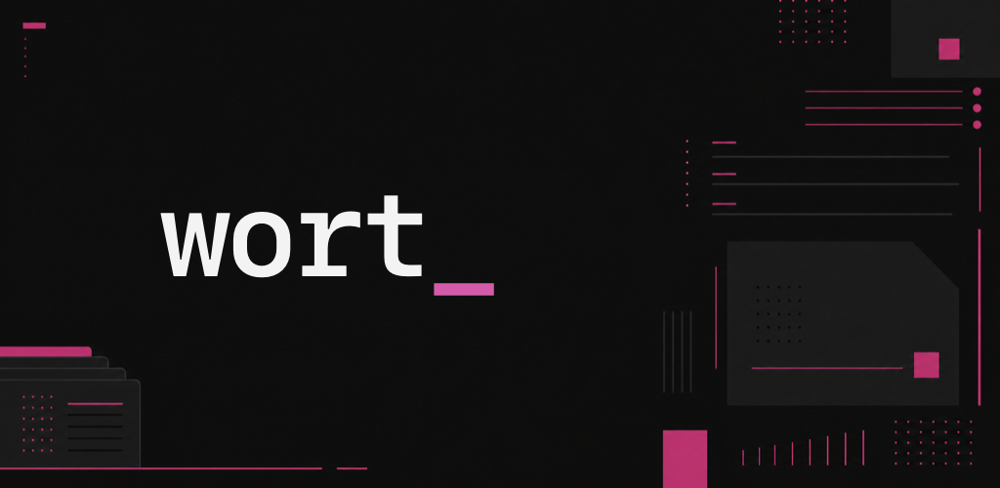

<div align="center">
  

  # wort_

  **Немецкий словарь, учебные материалы и осмысленные тренировки.**

  [](https://wort-five.vercel.app)
  [](https://github.com/YehorAltshuler/wort_/releases/latest/download/wort.apk)

  [English](README.md) · [Deutsch](README.de.md) · [Русский](README.ru.md)
</div>

## Учите немецкий в контексте

wort_ объединяет немецкий словарь на 29 599 слов, лексику учебников,
упражнения, личные списки и offline-first тренажёр **Leben in Deutschland**.
Одно адаптивное Flutter-приложение работает на Android, iOS и в Web.

### Возможности

- быстрый поиск, подробные карточки слов, примеры, формы и внешние источники;
- лексика четырёх учебников и 31 учебного модуля;
- тренировки, упражнения, избранное и пользовательские коллекции;
- все 460 вопросов LiD, выбор земли, экзамен, статистика и продолжение сессий;
- локальное хранение данных и безопасные фоновые обновления набора LiD;
- светлая и тёмная темы, цветовые палитры и адаптивный размер текста;
- русский, английский и арабский интерфейс приложения.

## Запуск

```bash
flutter pub get
flutter run --flavor native
```

Web запускается без flavor: `flutter run -d chrome`. Подробные инструкции есть
в [руководстве разработчика](docs/ru/DEVELOPMENT.md).

## Проверки

```bash
dart format --output=none --set-exit-if-changed .
flutter analyze
flutter test
flutter build web --release
```

## Документация

| Раздел | English | Deutsch | Русский |
| --- | --- | --- | --- |
| Архитектура | [Read](docs/en/ARCHITECTURE.md) | [Lesen](docs/de/ARCHITECTURE.md) | [Читать](docs/ru/ARCHITECTURE.md) |
| Разработка и релизы | [Read](docs/en/DEVELOPMENT.md) | [Lesen](docs/de/DEVELOPMENT.md) | [Читать](docs/ru/DEVELOPMENT.md) |
| Словарь | [Read](docs/en/LEXICON.md) | [Lesen](docs/de/LEXICON.md) | [Читать](docs/ru/LEXICON.md) |
| Leben in Deutschland | [Read](docs/en/LID_TEST.md) | [Lesen](docs/de/LID_TEST.md) | [Читать](docs/ru/LID_TEST.md) |

## Публикация

GitHub Actions проверяет форматирование, анализатор, тесты и Web-сборку. Теги
`v*` собирают `wort.apk` и прикрепляют его к GitHub Release. Web-приложение
публикуется в Vercel по конфигурации `vercel.json`.

## Лицензия

Открытая лицензия пока не предоставлена. Исходный код и включённые данные
остаются объектами прав их владельцев.
